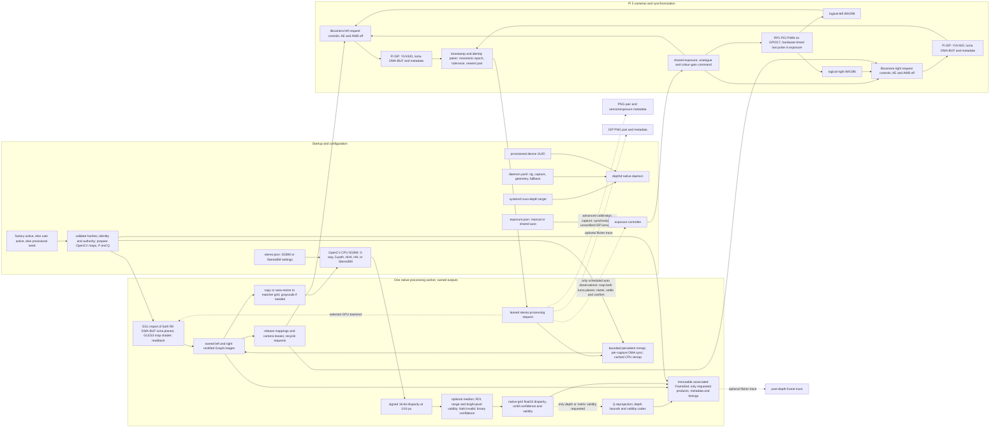
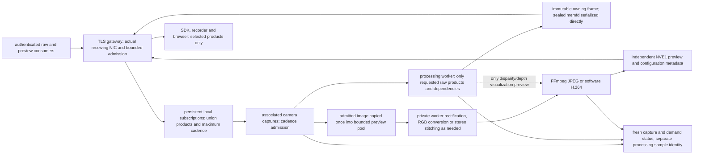
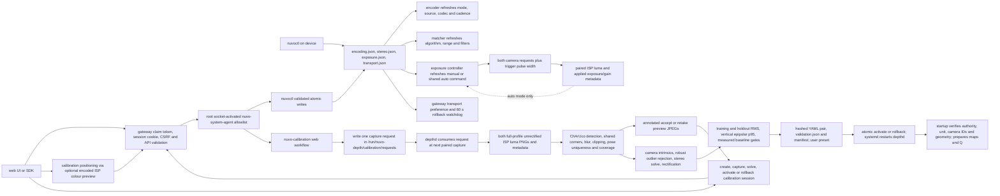

# Nuvo Depth repository and stereo image-pipeline map

Source audit updated: 2026-10-09. These diagrams describe the **arm64 native Pi 5 build and the code paths actually called by its services**. Solid arrows are active data/control paths; dashed arrows are conditional, alternative, or disconnected paths as labeled. The checked-in service uses 728 × 544 YUV420 capture at 10 Hz with the provisional 100 mm seed unless an active calibration bundle supersedes it. Both daemon YAML and `stereo.json` select 3-way SGBM with 128 disparities and two OpenCV threads. `encoding.json` defaults to raw-only; processing and delivery occur only for requested products. A 60 Hz experimental profile and half-resolution benchmark profile exist but are not the installed default.

## 1. Physical capture to associated depth products

Key details: libcamera configures **one VideoRecording stream per camera** in this backend; the main format is YUV420. The selected colour-preview side is copied from that ISP YUV420 buffer before its lease is released. The `left_color_stream: lores` / `RGB888` descriptors in the base YAML do not create a separate lores stream in the native capture code. GPU acceleration covers rectification only: matching, filtering, depth conversion, and FFmpeg encoding are CPU work. Cached CPU rectification is the measured default; GPU remains selectable. Raw image-only demand bypasses matching and metric conversion, and unrectified image demand bypasses rectification. Mono/RGB conversion and each camera remap are performed only when required by requested outputs. The scheduler has one replaceable pending request and one latest completed result; the pairer retains at most one unmatched frame per side.

The matcher works at the configured working grid. The installed profile is full-resolution 728 × 544; a separate half-resolution benchmark profile exists. Invalid disparity remains invalid through median filtering, and metric depth is computed from the matching-grid calibration rather than an image-only scale factor.

## 2. Demand, delivery and independent previews

Raw and preview consumers hold separate persistent subscriptions. No active
consumer means no raw processing, serialization or encoding; capture stays
prepared for fresh status, exposure and calibration requests. Disconnect removes
the consumer's demand. First-frame requests wait for matching selected products
within a bounded deadline. Images are admitted for preview independently of SGBM,
so a slow matcher cannot limit an image-only monitor to the depth frame rate.

Supported raw selections are each camera's unrectified mono/RGB and rectified
mono/RGB, rectified stereo side-by-side mono/RGB, disparity, depth, confidence and
validity. Legacy six-product subscriptions retain their original wire selections.
The gateway shares immutable fetched bytes and copies only selected subsets for
consumers. Atomic raw snapshots are an explicit diagnostic mode; normal delivery
uses the local socket rather than continuously writing full raw frames to disk.

The actual socket's receiving interface selects WiFi, Ethernet or USB Ethernet
policy. WiFi uses bounded best-effort delivery and an explicit byte budget;
qualified exact delivery requires matching recorded wired-link evidence. The
browser shows estimated product bandwidth and lets users choose products and
cadence. It never silently changes requested products or formats. Encoded depth
is a visualization; raw float depth retains the metric data.

## 3. Settings, exposure feedback and advanced calibration

The positioning preview is encoded; solver input is **not**. The daemon captures a synchronized raw ISP luma pair, and the calibration tool accepts/rejects it and solves from the saved raw PNGs. A passing web solve yields `user_validated` authority; factory activation has a separate signed trust path. Activation restarts depth processing so the new maps and Q are prepared together. Manual exposure uses one fixed exposure/gain command; shared auto samples both luma planes, observes clipping and median deadband, waits for confirmation/settling, then updates both requests and the XTR pulse.

## 4. What else lives in this repository

| Area | Role and production status |
| --- | --- |
| `apps/`, `src/core/`, `platform/pi5/`, `platform/linux/`, `include/depthd/` | Native Pi capture, pairing, processing, encoder, IPC and gateway described above. |
| `web/` | Claimed browser UI, raw canvas viewer, encoded monitor, exposure/matcher/transport editors, advanced calibration UI. Waiting/disconnected states show no photographic substitutes for live products. |
| `sdk/python/`, `include/nuvo/`, `src/sdk_c.cpp` | TLS snapshot/configuration clients, incremental C NUV1 decoder, Python NUV1/NVE1 decoders, NVR1 recording/replay. The local socket client helper is C++, not a Python SDK transport. |
| `tools/calibration/`, `src/calibration_store.cpp`, `config/calibration/` | ChArUco/chessboard solving, bundle validation/activation and startup rectification-map preparation. Provisional seed and sample matrix coexist with per-unit active bundles. |
| `tools/nuvoctl.py`, `tools/nuvo_system_agent.py`, `deployment/`, `debian/`, `qualification/`, `config/pi/` | Provisioning, boot overlay/trigger preparation, privileged controls, systemd, APT packaging and qualification gates. No package install auto-enables the camera target. |
| `CMakeLists.txt`, `CMakePresets.json`, `tools/release/` | Build variants and feature gates, source/SPDX generation, and vendor APT staging. The arm64 production build requires Pi capture, both CPU and GPU rectification support, OpenCV, FFmpeg, gateway and systemd. |
| `tools/pi/`, `tests/`, `tools/*benchmark*`, `docs/`, `presets/` | HIL checks, CPU/GPU/encoder profiling, flicker traces, unit/integration tests, validation reports, reference presets and operating documentation. These are not extra production frame stages. |
| `protocol/nuvo_stream_v1.proto`, `src/gateway.cpp` | Protocol schema and tested transport-admission core. The shipping gateway uses JSON wire metadata and persistent demand-driven local IPC, actual receiving-interface detection and bounded admission. |
| `src/depth_conversion.cpp` | Runtime Q-based float-metre depth conversion plus a separate optional float-depth to uint16-millimetre quantizer; the native frame set publishes float metres, not the quantized variant. |

## Source-verified boundaries

- Software FFmpeg JPEG/H.264 encoding consumes CPU; the Pi5 has no hardware
  video encoder in this path. Preview copies and transforms run only at admitted
  cadence and while a consumer needs them.
- The native backend creates one YUV420 main stream per camera. Legacy YAML
  lores/ROS/cloud descriptors do not create extra native processing stages.
  Legacy obstacle-cloud/result-ring processing has been retired.
- RP1 PIO PWM eliminates userspace pulse scheduling on the current GPIO17 wiring.
  Timing status distinguishes hardware commands from measurements. The kernel
  driver holds its last pin level when disabled; both cameras stop first.
- The checked-in calibration remains provisional. Output authority is preserved
  in raw and encoded metadata; throughput measurements do not establish metric
  accuracy for the final mechanical rig.

## Code anchors

- Capture/trigger/ISP and leases: [`platform/pi5/capture_libcamera.cpp`](../platform/pi5/capture_libcamera.cpp), [`platform/linux/capture_mapping.cpp`](../platform/linux/capture_mapping.cpp), [`src/core/pairer.cpp`](../src/core/pairer.cpp).
- Calibration/map preparation and runtime factory: [`src/calibration_store.cpp`](../src/calibration_store.cpp), [`src/core/runtime_factory.cpp`](../src/core/runtime_factory.cpp).
- Rectification, matching and depth: [`src/egl_gl_dmabuf_rectification_backend.cpp`](../src/egl_gl_dmabuf_rectification_backend.cpp), [`src/egl_gl_dmabuf_platform.cpp`](../src/egl_gl_dmabuf_platform.cpp), [`src/opencv_rectification_backend.cpp`](../src/opencv_rectification_backend.cpp), [`src/cpu_sgbm_backend.cpp`](../src/cpu_sgbm_backend.cpp), [`src/depth_conversion.cpp`](../src/depth_conversion.cpp), [`src/core/runtime.cpp`](../src/core/runtime.cpp).
- Publication/encoding/delivery: [`apps/depthd_main.cpp`](../apps/depthd_main.cpp), [`src/ipc_v2.cpp`](../src/ipc_v2.cpp), [`platform/linux/local_frame_server.cpp`](../platform/linux/local_frame_server.cpp), [`src/frame_wire.cpp`](../src/frame_wire.cpp), [`src/image_encoder.cpp`](../src/image_encoder.cpp), [`apps/nuvo_gateway_main.cpp`](../apps/nuvo_gateway_main.cpp), [`web/app.js`](../web/app.js).
- Controls/calibration/deployment: [`src/exposure_control.cpp`](../src/exposure_control.cpp), [`tools/nuvo_system_agent.py`](../tools/nuvo_system_agent.py), [`tools/calibration/nuvo_calibration.py`](../tools/calibration/nuvo_calibration.py), [`deployment/systemd/nuvo-depth.target`](../deployment/systemd/nuvo-depth.target), [`debian/rules`](../debian/rules).
