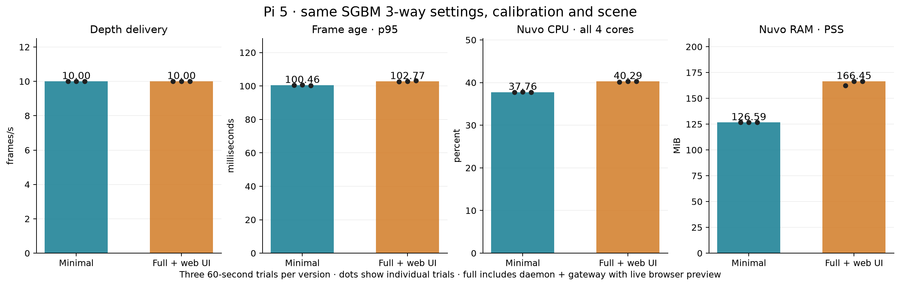

# Minimal versus full with a live web preview: SGBM on Pi 5

Physical Pi test on 2026-10-21. Both versions sustained the configured **10 Hz
depth rate**. Minimal used **2.53 percentage points less Pi CPU
(6.3% relative)** and
**39.86 MiB less proportional resident RAM
(23.9%)**. Its p95 capture-to-IPC frame age
was **2.31 ms lower**. These short trials establish a modest
resource saving at this workload; they do not measure maximum achievable FPS.

| Metric | Minimal | Full with web UI |
| --- | ---: | ---: |
| Depth delivery | 10.000 fps | 10.001 fps |
| Frame age, p50 | 99.45 ms | 101.28 ms |
| Frame age, p95 | 100.46 ms | 102.77 ms |
| Nuvo CPU, all four cores | 37.76 % | 40.29 % |
| Whole Pi CPU | 38.21 % | 40.95 % |
| Nuvo resident RAM, PSS | 126.59 MiB | 166.45 MiB |
| Summed process RSS | 135.28 MiB | 198.12 MiB |

Each entry is the median of three trial results. RAM uses each trial's median
of 1 Hz samples; p95 latency uses the median of three per-trial p95 values.
CPU is normalized to the Pi's four cores: 100% means all four cores fully busy.
Full totals include the native daemon and gateway. Workstation browser resources
are outside the Pi totals.

## Artifacts and controlled setup

Both package cohorts were built from source
`fa158f570ca513a3e878c552507872e9de509d11` by the manual ARM64 Actions workflow:

- [Minimal build 39686442512](https://github.com/arputhamips/nuvo-depth/actions/runs/39686442512):
  54/54 CTest checks and fresh-runtime installation.
- [Full build 39686445958](https://github.com/arputhamips/nuvo-depth/actions/runs/39686445958):
  56/56 checks and package installation smoke check.

These Actions artifacts carry `0.1.1~beta.6` metadata; the source commit and
package hashes identify the tested builds. No release assets were used or
replaced. No new ARM64 build was needed for this documentation-only result.

The Pi was a Raspberry Pi 5 Model B Rev 1.1, 16 GB, arm64 Trixie,
kernel `6.12.75+rpt-rpi-2712`, with the existing `ondemand` CPU governor.
The minimal package was already installed. Each profile's package payload was
extracted into an isolated directory, and its native executable was run as a
temporary systemd service with the existing capture configuration and per-unit
calibration. Full additionally ran its packaged HTTPS gateway and packaged web
UI. All 127 extracted regular files matched the workstation's artifact hashes;
running native/gateway executable hashes were checked through `/proc`.
This measures steady-state capture plus streaming, rather than installation
size, boot time, or unrelated full-system provisioning activity.

The settings were identical in both cohorts:

- 728 × 544, 10 Hz capture and raw output, CPU OpenCV rectification.
- SGBM `3way`, search range 128, minimum/maximum disparity 0/128, block size 5,
  median filter disabled, two OpenCV threads. Uniqueness 0, speckle window 30,
  speckle range 2, prefilter cap 31, disparity consistency difference 1.
- Manual exposure 8000 µs, analogue gain 2.0; reported exposure was 7999 µs
  in both cameras. Camera IDs and left/right assignment matched in every trial.
- The recovered beta 5 calibration geometry, source bundle
  `8adf4c8103f1fb7f2811a7d483669cc99c8c7132902700ebb3fd464d19158cf2`.
  The Pi's existing validated per-unit pair remained unchanged, authority 1,
  calibration SHA-256
  `41f14f56036d34b0a972e5b72dd1fd9cc6783862ca1da42313e86cd776f61d10`.
- One common Pi-local IPC subscription requested depth, validity and associated
  left ISP mono at 10 Hz (product mask 104). Mono snapshots verified the scene;
  no raw network transport was added to either cohort.

For full, the user kept the actual browser's Streaming page visible throughout
the three measured windows. Its default preview demanded **5 Hz H264 left color**,
728 × 544. Encoder configuration was 4 Mbps, one thread, `veryfast`, low latency,
keyframe interval 1. Each window encoded exactly 300 frames, and every 1 Hz
status sample retained 5 Hz preview demand. The encoder's configured ceiling
was 10 Hz; the browser requested 5 Hz. Minimal had no encoder or gateway.

## Measurement and individual trials

Each accepted window followed 15 seconds of active-stream warmup, then ran for
60 seconds. The accepted order was full-1b, full-2, full-3, minimal-2, minimal-3,
minimal-4. Full windows shared one daemon/gateway session to preserve the live
browser connection. Minimal-2 and minimal-3 shared a session; minimal-4 used a
fresh service start. These are repeated steady-state windows, not independent
cold boots or a randomized crossover experiment.

| Trial | Fresh depth frames | Delivery fps | Frame age p95, ms | Nuvo CPU, % of Pi | Median PSS, MiB |
| --- | ---: | ---: | ---: | ---: | ---: |
| full-1b | 600 | 9.9999 | 102.48 | 40.09 | 162.23 |
| full-2 | 600 | 10.0034 | 102.77 | 40.29 | 166.45 |
| full-3 | 601 | 10.0007 | 103.26 | 40.33 | 166.47 |
| minimal-2 | 600 | 10.0009 | 100.46 | 37.76 | 126.59 |
| minimal-3 | 601 | 10.0004 | 100.68 | 37.84 | 126.76 |
| minimal-4 | 600 | 9.9995 | 100.30 | 37.71 | 126.59 |

FPS is `(frames - 1) / (last arrival - first arrival)`, with strictly increasing
capture sequences and timestamps. Frame age is sensor `CLOCK_BOOTTIME` to the
local client's receipt of the IPC snapshot descriptor, before reading its pixel
payload. It includes capture and depth processing; it excludes network transit,
browser decode and display latency. Quantiles use nearest-rank p95.

CPU uses each service cgroup's `cpu.stat` usage delta over the measured window,
divided by elapsed time and four cores. Whole Pi CPU comes separately from
`/proc/stat`. The observer's small CPU cost is outside service totals and is
recorded in the JSON. Resident memory is sampled through `/proc/PID/smaps_rollup`
once per second. PSS apportions shared pages; summed RSS can count shared pages
twice. The kernel's memory cgroup controller was disabled. Sampled peaks are
not allocation high-water marks.

All **3602 delivered depth frames** were fresh and had zero delivered capture
sequence gaps. Completion, requeue, trigger and processing failure deltas were
zero. Full also had zero encode failures and encoding image-pool drops.
Status counter boundaries can differ by one frame from the received-frame window.
Unsupported optional counters are omitted from the sanitized evidence rather
than interpreted as zero. All windows reported `throttled=0x0`; trial median
temperatures ranged from 58.95 to 66.10 °C, with an overall sampled maximum
of 67.20 °C. The sequential test allowed temperature to rise.

Scene snapshots inside measured windows retained the same stationary board
placement and dim lighting. With a two-pixel Gaussian blur, the largest mean
absolute luma difference from the first accepted snapshot was
0.311/255. These are sequential live inputs, not byte-identical replay.

Three attempts were excluded:

- `minimal-1` completed a window, but its board position differed from all later
  trials. It was replaced by `minimal-4` after reviewing the scene snapshots.
- `full-1` had no live preview after the first profile switch. It failed the
  warmup requirement and supplied no accepted measurement window.
- `full-1a` stopped before warmup because an initial cached snapshot failed the
  freshness check. The temporary reader was corrected to advance past the
  initial cached cursor before accepting live frames; no product code changed.

The current calibration alignment discrepancy remains described in the
[calibration investigation](calibration-recording-investigation-20261021.md).
This performance comparison does not establish metric depth accuracy or resolve
that discrepancy.

## Restoration and evidence

The installed minimal service is running again with its original executable and
arguments. All 12 protected configuration, calibration, identity, service override
and boot file hashes stayed unchanged. Installed packages and CPU governors are
unchanged. All temporary services and the restoration timer are inactive, and
isolated runtimes and temporary web credentials were removed.
The restoration checker compares executable/arguments without systemd's volatile
start-time and PID fields.

[Sanitized JSON evidence](performance-minimal-full-sgbm-20261021.json) includes
per-trial distributions, settings, artifact/package/executable hashes, counters,
scene-difference measurements and restoration results. Raw frame/resource rows,
temporary observer source and private scene images remain in the local output
directory and the retained Pi evidence archive. No camera scene images or device
identity were added to the repository. No tag, signing job or release was created.
