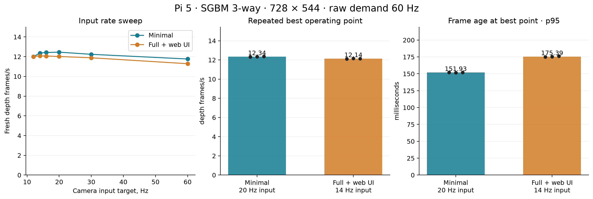

# Maximum measured depth throughput: minimal versus full on Pi 5

Physical Pi test on 2026-10-21, using Actions artifacts and unchanged SGBM
settings. With the 10 Hz benchmark limit removed, minimal sustained about
**12.34 depth FPS** and full with a live web preview sustained
**12.14 FPS** across three 60-second repetitions each.
The measured difference is **1.7%** in minimal's favor.

Both used a **60 Hz raw subscription**, with camera input swept through
12, 14, 16, 20, 30 and 60 Hz. The best tested input targets were
**20 Hz for minimal** and **14 Hz for full**.
Each profile was repeated at its own best tested capture target; use the sweep table for comparisons at identical input rates. Latency and CPU at different capture targets also include the different capture load.
This is the maximum measured over those input rates, not a mathematical optimum
over every fractional rate or an endurance qualification.

| Metric at repeated operating point | Minimal | Full with web UI |
| --- | ---: | ---: |
| Depth delivery | 12.341 fps | 12.138 fps |
| Frame age, p50 | 129.96 ms | 141.27 ms |
| Frame age, p95 | 151.93 ms | 175.39 ms |
| Nuvo CPU, all four cores | 49.35 % | 50.72 % |
| Whole Pi CPU | 50.36 % | 51.84 % |
| Nuvo resident RAM, PSS | 129.89 MiB | 164.17 MiB |
| Summed process RSS | 138.62 MiB | 196.30 MiB |

Entries are medians of three trial results. RAM first takes the median within
each trial; latency p95 is the median of three per-trial p95 values. CPU 100%
means all four Pi cores fully occupied. Full totals include native daemon plus
gateway; the workstation browser's CPU and RAM are excluded.

## What removing the cap changed

The previous [10 Hz comparison](performance-minimal-full-sgbm-20261021.md)
could only establish that both profiles reached their configured target.
Here the native daemon used temporary copies of its configuration with both
`capture.target_hz` and `outputs.disparity_hz` raised to each test input rate.
The IPC client requested 60000 millihertz in every case. The supported 60 Hz
IPC ceiling remained in place; it is far above the measured matcher throughput.
No capture, matcher or encoder implementation change was required.

Each sweep window had 15 seconds of warmup followed by 30 seconds of measurement.
The highest observed depth delivery rate selected each profile's operating point.
Camera input is a workload parameter: setting it to 60 Hz does not make the
matcher produce 60 depth frames per second. More capture work can reduce depth
throughput even while latency falls because a more recent pair is available.

| Camera target, Hz | Minimal depth FPS | Full depth FPS | Minimal pending replacements | Full pending replacements | Full encoded preview FPS |
| ---: | ---: | ---: | ---: | ---: | ---: |
| 12 | 12.002 | 12.005 | 0 | 0 | 3.998 |
| 14 | 12.370 | 12.089 | 49 | 58 | 4.662 |
| 16 | 12.423 | 12.065 | 108 | 119 | 3.996 |
| 20 | 12.459 | 12.020 | 227 | 240 | 4.999 |
| 30 | 12.239 | 11.888 | 533 | 546 | 4.993 |
| 60 | 11.767 | 11.289 | 1447 | 1468 | 4.997 |

For a direct comparison at identical 20 Hz input, the short sweep gave
12.459 versus 12.020 depth FPS,
150.98 versus 154.99 ms p95 age,
and 49.44% versus 51.57%
of the four-core CPU (minimal versus full). Full's preview delivered 5 FPS there.

Pending replacements are deliberate overload handling: the bounded scheduler
keeps a recent pending pair instead of growing an input queue. They are distinct
from camera completion, requeue, trigger and processing errors. Maximum sustained
output does not imply that every captured pair is processed. The table records
the no-replacement result at 12 Hz separately from the overloaded maximum tests.

## Matched setup and Actions provenance

Both profiles came from source
`fa158f570ca513a3e878c552507872e9de509d11`:

- [Minimal Actions run 39686442512](https://github.com/arputhamips/nuvo-depth/actions/runs/39686442512),
  54/54 CTest checks and fresh-runtime installation.
- [Full Actions run 39686445958](https://github.com/arputhamips/nuvo-depth/actions/runs/39686445958),
  56/56 checks and package installation smoke check.

The packages retain `0.1.1~beta.6` metadata; source and artifact hashes identify
these tests. There was no new release or tag, and no package rebuild was needed
for the runtime configuration experiment. All 127 regular payload files were
verified before and after the benchmark. Running daemon/gateway executable hashes
were checked through `/proc`.

Hardware was the existing Pi 5 Model B Rev 1.1, 16 GB, arm64 Trixie,
kernel `6.12.75+rpt-rpi-2712`, stock `ondemand` governor. Installed packages were
preserved. Both artifact payloads ran from isolated directories as temporary
systemd services with the existing camera permissions and per-unit calibration.
Full added its packaged gateway and actual browser console. Its configuration
agent was not started, so the temporary console's Apply actions were unavailable;
this tests streaming performance with fixed settings, not configuration saving.

The controlled settings were:

- 728 × 544, CPU OpenCV rectification, same physical camera assignment.
- SGBM `3way`, 128 disparities, disparity bounds 0–128, block size 5, two
  OpenCV threads, median filter disabled, uniqueness 0, speckle window 30,
  speckle range 2, disparity consistency difference 1 and prefilter cap 31.
- Manual 8000 µs exposure, gain 2.0, unchanged trigger pulse width and ISP controls.
- Recovered beta 5 calibration geometry from bundle
  `8adf4c8103f1fb7f2811a7d483669cc99c8c7132902700ebb3fd464d19158cf2`.
  Existing per-unit authority 1 and calibration hash
  `41f14f56036d34b0a972e5b72dd1fd9cc6783862ca1da42313e86cd776f61d10`
  remained unchanged throughout.
- Common local IPC products: depth, validity and associated left ISP mono
  (mask 104). Mono snapshots verified scene placement; pixel payloads were read
  only for the occasional scene snapshots.
- Full's browser requested 5 Hz H264 left color, 728 × 544, 4 Mbps, one encoder
  thread, `veryfast`, low latency, keyframe interval 1. Preview request cadence
  stayed 5 Hz in every 1 Hz sample. Actual encoded preview delivery at the repeated
  point was 4.665–4.682 FPS. Input-rate quantization can
  make actual preview cadence lower than the 5 Hz request, as shown in the sweep.

The scene retained the same board placement. Phase correlation estimated at most
0.612 px of relative image shift across the sampled left images.
Brightness varied during the sweeps: full-image mean luma ranged from
11.79 to 14.80/255, with up to 2.944/255 mean absolute luma
difference after a two-pixel Gaussian blur. Within the repeated maximum windows,
that difference was at most 0.207/255. These were sequential live
captures rather than identical replay. This scene-placement check does not
measure stereo calibration accuracy.
Private scene images are retained locally and are not committed.

## Repetition and stability

Each selected operating point had three 60-second measured windows, each
following 15 seconds of active-stream warmup. Repetitions within a profile shared
one running capture process; full also retained the same gateway and browser
connection across capture-rate changes. These are steady-state windows rather
than independent cold starts. Minimal sweeps ran first, then full sweeps and
repetitions, then minimal repetitions.

| Trial | Fresh depth frames | Delivery FPS | Frame age p95, ms | Nuvo CPU, % of Pi | Median PSS, MiB |
| --- | ---: | ---: | ---: | ---: | ---: |
| minimal-max-1 | 741 | 12.3298 | 152.11 | 49.37 | 129.69 |
| minimal-max-2 | 740 | 12.3407 | 151.55 | 49.35 | 129.89 |
| minimal-max-3 | 742 | 12.3676 | 151.93 | 49.34 | 129.89 |
| full-max-1 | 727 | 12.1107 | 175.11 | 50.78 | 164.07 |
| full-max-2 | 730 | 12.1589 | 175.39 | 50.72 | 164.17 |
| full-max-3 | 728 | 12.1382 | 176.03 | 50.67 | 164.21 |

Across repeated maximum windows, ten-second depth rates ranged from
12.084 to 12.381 FPS. Maximum observed frame age was
185.93 ms. Last-third minus first-third median frame age ranged from
-1.14 to +1.76 ms, consistent with a bounded
latest-pair queue rather than accumulating seconds of backlog. Per-window
rates and age slopes are retained in the JSON.

FPS counts unique increasing capture identities using
`(frames - 1) / (last arrival - first arrival)`. Latency is sensor
`CLOCK_BOOTTIME` to Pi-local receipt of the IPC snapshot descriptor, before pixel
payload reads. It excludes network transport, browser decode and display.
P95 uses nearest rank. Service CPU comes from cgroup `cpu.stat` deltas;
whole-Pi CPU comes separately from `/proc/stat`. PSS/RSS are sampled at 1 Hz
through `/proc/PID/smaps_rollup`; PSS apportions shared pages and summed RSS can
double-count them. The kernel memory cgroup controller was disabled.

Accepted windows had zero camera completion, requeue, trigger and processing
failures. Full had zero encode failures or encoding image-pool drops.
All reported `throttled=0x0`; maximum sampled temperature was 74.35 °C.
One first full attempt was excluded because the browser paused its preview when
it left the foreground; it produced no accepted result. The retry remained active.

The [existing alignment discrepancy](calibration-recording-investigation-20261021.md)
remains separate from this throughput measurement. Calibration was preserved;
the benchmark does not qualify metric depth accuracy.

## Restoration and evidence

The original installed minimal service is running again with its original
configuration, including its original 10 Hz target. All 12 protected configuration,
calibration, identity, boot and service-override file hashes are unchanged.
Installed packages and CPU governors are unchanged. Temporary services and the
restoration timer are inactive; extracted runtimes and test web credentials were
removed. No product default, release asset or installer was changed.

[Sanitized JSON evidence](performance-minimal-full-sgbm-max-20261021.json) contains
all accepted sweep and repetition statistics, rate/latency stability, settings,
artifact hashes, executable hashes and restoration checks. Raw frame/resource
rows, observer source and private scene snapshots remain in the Pi/workstation
evidence archive, whose hash is recorded in the JSON.
