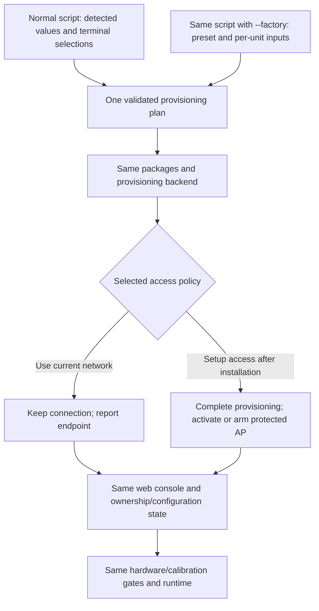

# Shared setup contract for UF-01 and UF-02

> Browser-access update (v0.1.1-beta.5): the HTTPS console now opens directly,
> without a login, setup code or owner-password step. Ownership/login proposals
> below are historical and do not describe the current browser or installer.
> Network setup, certificate verification and calibration requirements still apply.

**Specification:** SETUP-01 · **Version:** 0.3 · **Updated:** 19 October 2026  
**Status:** Shared installer, ownership and protected-hotspot backend implemented and published as a signed GitHub beta. Both entry flows have physical Pi setup evidence; see [qualification scope](../release-qualification-20261019.md#uf-01-and-uf-02-physical-setup-acceptance) and [implementation limits](../install.md). Manufacturing acceptance remains separate.

## One installer, one product, two input modes

[UF-01](user-flow-use-case-1.md) is the customer journey for a factory-prepared appliance. [UF-02](user-flow-use-case-2.md) is the technical user's terminal installation. Both use **the same script, resolved configuration plan, package cohort, provisioning backend, ownership store, web UI and runtime**.

Normal script execution asks the required questions in the terminal and applies the approved answers. `--factory` skips those questions and supplies a versioned manufacturing preset plus available per-unit data. The flag changes how inputs are obtained, not the validation or installation path.

| Concern | Normal terminal mode | Factory preset |
| --- | --- | --- |
| Inputs | Detect current state, ask missing required questions, show summary and confirm. | Versioned defaults plus per-unit manufacturing inputs; no selection prompts. |
| Network | Choose **Use current network** (default) or **Set up network after installation** through a protected AP. | Customer setup AP armed for the shipping handoff; no assumed customer Wi-Fi. |
| Hardware/calibration | Detect/ask for head, mapping, restore record or bundle when needed. | Use the qualified product profile and matching per-unit evidence. Missing facts remain pending. |
| Ownership | Set owner credential now, preserve an existing owner, or explicitly defer claiming. | Leave customer ownership unclaimed; generate unique per-unit setup material. |
| Provisioning | Apply the approved common plan and validate actual results. | Apply that same plan and validation without operator selections. |
| Web UI | Login and status; ask only for intentionally deferred or unresolved work. | Customer network/owner handoff and the same console; verified factory facts are reused. |

No Nuvo desktop installer is required. The normal terminal flow is intentionally interactive; this supersedes earlier designs that prohibited terminal questions or deferred every input to the web UI.

## Separate input mode, origin, access policy and ownership

Do not use a single factory/terminal profile as a shortcut for all behavior. Model these facts separately:

| Dimension | Representative values | Meaning |
| --- | --- | --- |
| Input mode | Prompted, factory preset | How this invocation obtains its plan; not a permission grant or reset. |
| Installation origin | Factory, user terminal | Initial provenance/audit information; not an AP or calibration decision. |
| Access policy | `keep_current`, `setup_ap` | Explicit normal-user selection or factory preset. |
| Access stage | Staged, armed, active, confirmed | Whether the selected handoff is ready, applied or finished; transaction details are journaled. |
| Ownership | Unclaimed, claimed | Authoritative owner store, independent of access mode. |
| Installation | In progress, installed, failed; reboot pending separately | Actual package/platform preparation state. |
| Hardware/calibration | Pending/verified/failed; missing/provisional/accepted/mismatch | Current checks and authoritative calibration evidence, never inferred from the flag. |

Persist the approved plan, progress and operation journal in a root-owned versioned setup record; `/var/lib/nuvo-depth/setup/state.json` is an illustrative location. Keep identity, credentials, network profiles and calibration in their authoritative stores rather than duplicating their secrets or authority in this record.

A normal user may select `setup_ap` and create their owner credential before the AP handoff. That device remains owned and user-installed. Conversely, a factory-origin unit may later use an owner-configured existing network. Factory origin does not force it back to a hotspot.

`web_ready`, `cameras_working` and `metric_depth_ready` remain distinct. A successful installation, owner creation or AP connection does not establish accepted metric depth.

## Normal terminal selection contract

The script prechecks/detects facts, asks for required missing information, and presents a single resolved plan before changes. It can ask for the access option, optional display name, hardware/head or restore record, required camera mapping, calibration bundle, owner credential/deferred claim choice, supported operating preset, startup behavior and restart/handoff action. Known valid facts are prefilled rather than repeatedly requested.

Use masked credential input; passwords must not be passed as ordinary command arguments, stored in plaintext answers files or copied into logs. An owner credential set in the terminal belongs to Nuvo, not the OS login. Physical calibration measurements cannot be invented by answering a prompt; record that work as pending when necessary.

The web UI reads these same settings. It does not run a second questionnaire or overwrite terminal choices with separate defaults. If the user chose current networking and configured ownership/head/calibration, the browser goes to owner login and the normal console. If the user deliberately deferred network setup, the protected AP page collects the destination network later.

## Factory flag contract

`--factory` supplies a reviewed, versioned preset and available per-unit data. It skips selections/confirmation prompts but retains supported-OS checks, package authentication, configuration validation, hardware checks and calibration authority checks. Manufacturing can cache qualified packages or use the offline bundle to reduce download time; speed is not obtained by skipping acceptance.

Factory defaults arm customer setup-AP access, leave customer ownership unclaimed, select the supported product profile and startup policy, and create unique identity/keys/AP/pairing material for the actual unit. Static choices are shared; secrets and per-unit calibration are not.

Image builders may install common package files but must not clone unit identities, ownership or private keys. Per-unit generation/association happens on the target or through the authorized manufacturing process, not by identifying the build host as the target Pi.

A supplied signed calibration/recovery record still has to match the actual unit/cameras. Factory mode does not grant signing authority, erase a mismatch, invent electrical evidence or set shipping readiness solely because software installed. Pending manufacturing tasks remain explicit and block shipment until the release gates pass.

Factory installation may use a bench network while provisioning. The final handoff must not mistake that connection for a customer network or leave manufacturing Wi-Fi credentials in the shipped configuration. Remove only identified temporary manufacturing profiles through the documented production process; unexpected persistent network state blocks sealing rather than being erased indiscriminately. Customer AP access is armed/activated at the planned handoff or boot, after package and production work completes.

Rerunning on a partial compatible unclaimed factory unit preserves its identity, secrets and progress. On an owned/conflicting customer installation, `--factory` fails with an explicit reprovision/reset requirement. It is not a force-reset flag. Existing factory/customer state is never reset just because a default changed in a newer preset.

## Network and AP decisions

| Condition | Required behavior |
| --- | --- |
| A network transaction is already active | Resume it, including deadline/rollback. Do not run an independent AP decision against the same radio. |
| Packages/provisioning are still using the current link | Keep it until their work and durable state are complete, even if `setup_ap` was selected. |
| `keep_current` selected or retained | Preserve the current network and report the endpoint. Unclaimed ownership or camera failure does not change that decision. |
| `setup_ap` selected, but handoff is only staged/armed | Show/record the future SSID, unique password, setup URL and owner instructions; retain the current link until the approved activation/reboot. |
| `setup_ap` activation is authorized and prerequisites are complete | Apply the deliberate transition, including replacing a Wi-Fi station connection if required by a single radio. Preserve the previous profile for activation-failure recovery. |
| AP-to-station destination configuration fails | Restore the protected AP/known usable route under the same connection transaction; retain useful error information. |
| Destination networking is confirmed | Finish temporary AP provisioning and retain the working selected connection. The original `setup_ap` answer does not mean AP on every boot. |
| Owned device later loses network/internet | Retry configured networking. A past AP choice, loss of internet or unclaimed flag does not reopen initial setup independently. |
| Explicit owner/admin/physical recovery requested | Open a bounded recovery transaction and preserve ownership/calibration. This is separate from first ownership claiming. |
| Setup state is missing/corrupt | Preserve current connectivity/credentials and provide administrator repair. Never infer a factory hotspot or open claim route. |

For an SSH install using the same Wi-Fi radio, the script must state that AP activation will disconnect that session. Print credentials/instructions first and persist all work. Do not interrupt downloads, dpkg or provisioning by switching early. Starting an intentional setup AP is different from an accidental connection failure; distinguish activation failure from the customer's later destination-network transaction.

Use the existing NetworkManager as network authority. One operation owns the radio at a time. DHCP/DNS for setup are limited to setup interfaces, never the customer's existing LAN. Do not assume simultaneous AP/station operation or take over unrelated default routes.

The isolated HTTP bootstrap listener, if used under UF-01's trust tradeoff, has only the limited network-setup authority granted by the active protected provisioning/recovery transaction. It is not an HTTP administrative gateway. Once reachable, both flows use the same HTTPS ownership/configuration and console. An owned device uses its owner login; starting an AP must not make it unclaimed.

## Shared ownership and web behavior

One ownership backend supports three authorized entry contexts: direct first-owner creation through the authenticated terminal administrator, bounded factory claiming, or bounded administrator-issued deferred claiming. Enforce one-owner atomicity, unit binding and applicable credential/capability rules. Deferred/factory capabilities are limited, consumed and attempt-controlled; established owner passwords are not treated as short-lived pairing codes.

Existing claimed units retain owner credentials and login. Reissue/recovery is explicit. The first LAN browser, a known serial, the `--factory` argument or origin metadata is not independently proof of ownership. Sensitive web operations require the owner or the appropriate narrowly scoped provisioning capability.

The same web UI renders the authoritative results:

- Reuse terminal/factory answers and verified head/calibration state; do not ask them again.
- Ask for destination SSID/password only when network setup was deliberately deferred or an authorized change is requested.
- Offer trusted restoration/association and advanced calibration only when needed; do not weaken binding checks.
- Remain reachable without a healthy capture process so pending setup can be resolved.
- Report accepted calibration only from actual verified evidence, independent of input mode or origin.

Both paths share HTTPS trust, hostname/discovery and SDK policies. Report actual configured listeners/endpoints, not a port hardcoded by flow name. Engineering 17443 and shipping 7443 conventions must not be selected just because a user entered by terminal or AP. Root authorization does not silently establish trust in a remote browser; that certificate lifecycle remains shared qualification work.

## One mutation backend and durable lifecycle

APT hooks install files/accounts and documented identity scaffolding, preserving valid state; they do not independently decide AP access or ownership. The script normalizes prompted/default answers into one plan. A shared backend serializes conflicting network, boot, service, identity and calibration operations and records progress before a restart. System managers and credential/calibration stores retain their own authority.

Terminal commands and web pages display the same status. Conflicting mutations receive a busy/conflict outcome; read-only status remains available. Installed workers survive SSH disconnect and execute trusted installed code, not later-modifiable downloads from a user's home directory.

Rerun/repair preloads existing values and offers preserve or explicit supported reconfiguration. Updates and reruns do not reset ownership, regenerate valid keys, overwrite calibration or reopen an already confirmed access stage. Reset, network recovery and data purge are distinct actions. Replacing an SD and restoring calibration does not import old network choices or consumed claims without an explicitly approved restoration scope.

## Cross-flow acceptance

| Scenario | Expected result |
| --- | --- |
| Normal install, current network selected | Prompted required inputs; preserve link; configure owner now or bounded deferred claim; same console. |
| Normal install, deferred access selected over Wi-Fi SSH | Complete installation first; print AP details; persist work; switch only at approved handoff/reboot. |
| Normal install creates owner before AP switch | AP appears as selected but ownership remains claimed; browser uses owner login. |
| Factory mode with complete valid per-unit inputs | No selections; same packages/backend; unique setup material; customer ownership unclaimed; AP handoff armed. |
| Factory inputs missing calibration or acceptance evidence | Installation and pending manufacturing status accurately reported; shipping readiness not asserted. |
| Factory flag on owned customer unit | No silent reset/rekey/network replacement; explicit conflict/reprovision result. |
| Interrupted package/network work | One durable transaction resumes or rolls back; no independent AP daemon races it. |
| Installer and web edits overlap | Serialize mutations and expose the same status, with clear conflict handling. |
| Completed unit reboots/upgrades | Preserve confirmed network, credentials and valid calibration; no repeated setup. |
| Replacement card on factory hardware | Prompt for access policy; restore authorized head/calibration facts separately from network/ownership policy. |
| Camera failure or missing setup state | Preserve access/ownership; accurate pending/repair state, no automatic factory claiming. |

This contract governs ambiguous entry-flow wording. Implement the common plan/backend first and put the prompted and factory input modes around it. This specification update changes no runtime code and performs no hardware tests.
